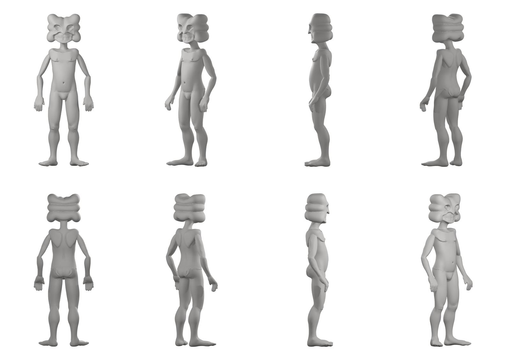

# GUMBIT — 3D test model

First pass at Gumbit in three dimensions.

**[gumbit.stl](gumbit.stl) — click it. GitHub loads a 3D viewer.**
Drag to spin, scroll to zoom.

## Where this came from

PJ's line-art turnaround → clay render → photogrammetry-style 3D
reconstruction → mesh.

## What to look at

- The head came through intact — slab stack, side lobes, the grin
- Feet and hands are present and separated
- Front and 3/4 are the good angles

## What's still wrong

- **The profile is guessed.** The model was built from front and back
  views only, so from a dead side angle the head reads thin and a
  little lopsided. Side views are the next thing to draw.
- **Surface detail is soft** — the teeth and carved eyes from the clay
  render didn't survive. That's a resolution cap, not a design problem.
- **Not print-ready.** Ankles and fingers are below minimum thickness,
  and the mesh isn't watertight.

This is a blockout for looking at, not a file for printing.
